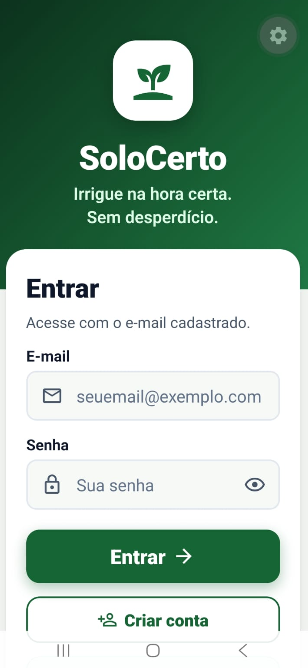
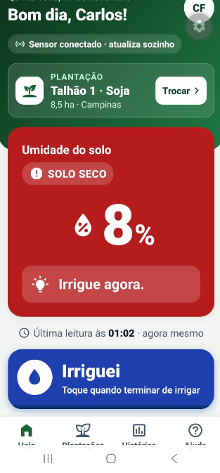
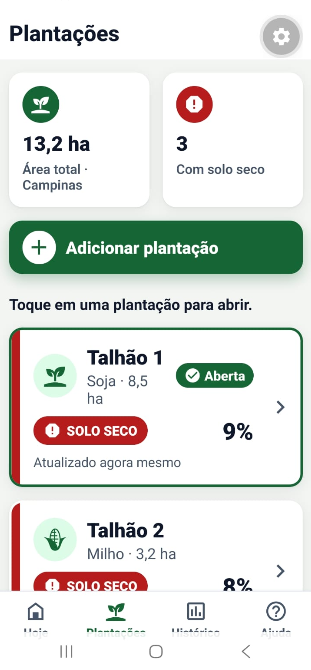
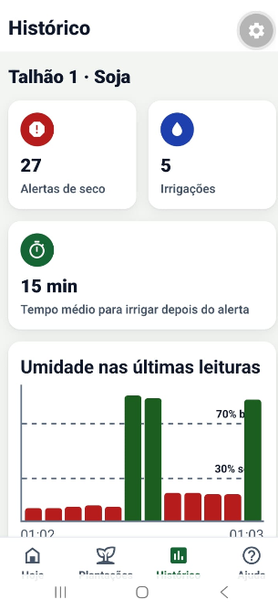
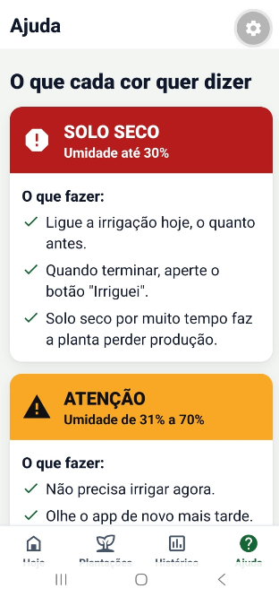

# SoloCerto 🌱

Aplicativo mobile da Global Solution FIAP **CitizenTech**. Ajuda o pequeno produtor rural a irrigar na hora certa, com base na umidade real do solo.

---

## Ficha da CitizenTech

| Item | Descrição |
|---|---|
| **Nome** | SoloCerto |
| **Cidade / bairro** | Campinas (SP), zona rural |
| **Cidadão atendido** | Pequeno produtor rural. Persona fictícia: Carlos Ferreira, soja, 8,5 hectares |
| **Problema (em uma frase)** | O pequeno produtor irriga "no olho": gasta água quando não precisa ou deixa o solo secar e perde produção. |
| **Como funciona** | Um sensor ESP32 na lavoura mede a umidade do solo e envia as leituras para uma API. O app mostra ao produtor, em linguagem simples, se o solo está **seco, médio ou bom** e o que fazer. Quando irriga, ele aperta **"Irriguei"**, e o sistema registra quanto tempo ele levou para responder ao alerta. |
| **O que cada parte faz** | **ESP32 + sensor:** mede a umidade do solo, a umidade do ar e a temperatura, e envia à API.<br>**API Java / Spring Boot:** guarda as leituras e os eventos de cada plantação.<br>**App (este repositório):** mostra a situação do solo, o histórico e a ajuda, e registra as irrigações. Funciona sem internet. |
| **Repositório** | `https://github.com/SEU-USUARIO/solocerto-app` *(trocar pelo link real)* |
| **Indicador de impacto** | **Tempo médio de resposta ao alerta crítico**: minutos entre o alerta de solo seco e o "Irriguei". Aparece na tela Histórico. Indicadores de apoio: número de alertas críticos por semana e número de irrigações feitas com solo já BOM (água desperdiçada). |
| **ODS** | **ODS 2** (Fome Zero e Agricultura Sustentável): menos perda de produção.<br>**ODS 13** (Ação Contra a Mudança do Clima): uso consciente da água em períodos de seca.<br>**ODS 9** (Indústria, Inovação e Infraestrutura): IoT de baixo custo no campo.<br>**ODS 10** (Redução das Desigualdades): tecnologia acessível para o pequeno produtor, não só para o agronegócio grande. |

---

## Telas

| Tela | O que mostra |
|---|---|
| **Login** | E-mail e senha. Quem já entrou não precisa digitar de novo. No modo demonstração há um botão que preenche a conta de teste. O botão **Criar conta** abre o cadastro. |
| **Criar conta** | Nome, cidade, e-mail, senha e repetir a senha. O app confere os dados antes de enviar (e-mail válido, senha com 6+ caracteres, senhas iguais) e avisa se o e-mail já tem conta. A conta nova já entra direto. |
| **Hoje** | Um topo verde com a saudação, a data, o status da conexão e a plantação aberta (com o botão **Trocar**). Embaixo, a umidade atual em número grande, o estado (cor, ícone e texto), o horário da última leitura, o botão grande **"Irriguei"**, a régua de umidade e o clima. |
| **Plantações** | Todas as plantações do produtor, cada uma com a situação do solo agora. Ao tocar numa plantação, ela fica aberta e o app volta para a tela Hoje. A escolha fica salva no celular. O botão **Adicionar plantação** abre o cadastro de uma plantação nova. |
| **Nova plantação** | Nome, cultura (botões grandes: soja, milho, feijão, café, hortaliças, mandioca ou "Outra") e tamanho em hectares (aceita vírgula). Ao salvar, a plantação nova já fica aberta na tela Hoje. Precisa de internet, porque o id vem do servidor. |
| **Histórico** | Resumo com alertas, irrigações e tempo médio de resposta. Embaixo, um gráfico de barras das últimas leituras e a lista com todas as leituras, alertas e irrigações. |
| **Ajuda** | O que significa cada cor e o que fazer em cada caso, como o sistema funciona e o que acontece sem internet. No fim, os dados da conta e o botão **Sair da conta**. |

### Regras de estado

| Umidade do solo | Estado | Cor | Ícone | Mensagem |
|---|---|---|---|---|
| até 30% | `CRITICO` | vermelho | octógono de alerta | **SOLO SECO**: Irrigue agora. |
| 31% a 70% | `MODERADO` | amarelo | triângulo de alerta | **ATENÇÃO**: ainda não precisa irrigar. |
| acima de 70% | `BOM` | verde | check | **SOLO BOM**: não irrigue. |

### Prints das telas

> Tire os prints no celular e salve na pasta `docs/prints/` com estes nomes.

| Login | Criar conta | Hoje | Plantações | Nova plantação | Histórico | Ajuda | Sem internet |
|---|---|---|---|---|---|---|---|
|  |  |  |  |  |  |  |  |

---

## Como rodar

Pré-requisitos: **Node.js 20 ou superior** e o app **Expo Go** no celular (Android ou iOS).

```bash
npm install
npx expo start
```

Depois, leia o QR Code com o Expo Go (Android) ou com a câmera (iOS). O celular e o computador precisam estar na mesma rede Wi-Fi.

Também roda no navegador com `npx expo start --web`.

### Login de demonstração

| E-mail | Senha |
|---|---|
| `carlos@example.com` | `123456` |

Na tela de login, o botão **"Usar conta de demonstração"** preenche os campos. A conta e os dados são fictícios.

Também dá para **criar uma conta nova** no modo demonstração. Ela começa sem plantações: a tela Hoje mostra o botão **Adicionar plantação**. As contas e plantações criadas ficam num banco SQLite separado (`mock-servidor.db`), que faz o papel do banco do servidor. Assim elas continuam existindo depois de sair e entrar de novo.

### Mock ou API real

Por padrão o app usa **dados simulados** (mock), então não precisa de servidor. Para usar a API real:

1. Copie `.env.example` para `.env`.
2. Ajuste o arquivo:
   ```env
   EXPO_PUBLIC_USE_MOCK=false
   EXPO_PUBLIC_API_URL=http://IP-DO-COMPUTADOR:8080
   ```
3. Reinicie com `npx expo start --clear`.

As telas não mudam: só a implementação por trás de `src/services/api.ts` é trocada.

Endpoints que o app espera da API Spring Boot:

| Método | Rota | Retorno |
|---|---|---|
| POST | `/auth/login` `{ email, senha }` | `{ token, usuario: { id, nome, email, cidade } }`, ou status 401 se estiver errado |
| POST | `/auth/cadastro` `{ nome, cidade, email, senha }` | igual ao login (`{ token, usuario }`), ou status 409 se o e-mail já tiver conta |
| GET | `/plantacoes` | lista de `Plantacao` `{ id, nome, cultura, hectares }` do produtor logado |
| POST | `/plantacoes` `{ nome, cultura, hectares }` | a `Plantacao` salva, com `id` |
| GET | `/leituras?plantacaoId=1` | lista de `Leitura` (mais recente primeiro) |
| GET | `/leituras/ultima?plantacaoId=1` | uma `Leitura` |
| POST | `/leituras` (corpo com `evento: "irrigacao_confirmada"`) | a `Leitura` salva, com `id` |

Depois do login, todas as chamadas enviam o cabeçalho `Authorization: Bearer <token>`.

### Testar o modo sem internet

Ative o **modo avião** com o app aberto. Aparece o aviso **"Sem internet"**, o histórico continua visível e o botão "Irriguei" continua funcionando: o registro fica salvo no celular como "aguardando internet". Quando a internet volta, o registro é enviado sozinho.

---

## Contrato de dados

É o mesmo formato que o ESP32 envia:

```json
{
  "id": 1731681000000,
  "plantacaoId": 1,
  "evento": "leitura | alerta_critico | irrigacao_confirmada",
  "umidadeSolo": 42,
  "umidadeAr": 58.3,
  "temperaturaAr": 28.1,
  "estado": "CRITICO | MODERADO | BOM",
  "tempoReacaoSeg": null,
  "criadoEm": "2026-11-15T14:30:00.000Z"
}
```

`tempoReacaoSeg` só vem preenchido em `irrigacao_confirmada`. É o número de segundos entre o **primeiro alerta crítico ainda sem resposta** e o toque em "Irriguei".

---

## Estrutura do projeto

```
app/                         TELAS (Expo Router: cada arquivo é uma tela)
  _layout.tsx                Raiz: SQLite + SessaoProvider + Stack.Protected (login x área logada)
  login.tsx                  Tela de login
  cadastro.tsx               Tela "Criar conta"
  (app)/                     Área logada (só para quem entrou)
    _layout.tsx              DadosProvider + Stack (abas e "Nova plantação")
    nova-plantacao.tsx       Tela "Nova plantação" (formulário)
    (tabs)/                  Grupo das abas
      _layout.tsx            Abas
      index.tsx              Tela "Hoje"
      plantacoes.tsx         Tela "Plantações" (ver, escolher e adicionar)
      historico.tsx          Tela "Histórico"
      ajuda.tsx              Tela "Ajuda" + conta / sair
src/
  types/leitura.ts           Tipos do contrato + regra calcularEstado()
  types/plantacao.ts         Tipos Plantacao e NovaPlantacao
  types/usuario.ts           Tipos Usuario, Sessao, NovaConta, ErroLogin e ErroCadastro
  services/
    api.ts                   Interface única SoloCertoApi + escolha mock/http
    mockApi.ts               Simulação do ESP32 + API (conta demo com 3 plantações; contas e plantações novas no mock-servidor.db)
    httpApi.ts               API real via fetch (pronta para o Spring Boot)
  db/
    database.ts              Cria as tabelas no SQLite (migrações v1 e v2)
    leiturasDb.ts            Funções de ler e gravar leituras e irrigações
    plantacoesDb.ts          Plantações + preferências (plantação escolhida)
  context/DadosContext.tsx   "Cérebro": junta API + SQLite + internet (com fila)
  context/SessaoContext.tsx  Login: entrar, criar conta, sair, lembrar a sessão
  components/                Peças visuais reutilizáveis
    CampoTexto.tsx           Campo com rótulo, ícone e mostrar/esconder senha
    Cartao.tsx               Cartão branco com sombra (base visual)
    CartaoEstado.tsx         Cartão grande com umidade e estado
    ReguaUmidade.tsx         Barra Seco | Médio | Bom com seta "você está aqui"
    InfoMini.tsx             Cartãozinho ícone + valor (clima, resumo)
    BotaoGrande.tsx          Botão "Irriguei"
    Faixa.tsx                Avisos: sem internet, erro e sucesso
    GraficoUmidade.tsx       Gráfico de barras feito só com View
    ItemHistorico.tsx        Linha da lista do histórico
  constants/
    tema.ts                  Cores, tamanhos de fonte, alvo de toque mínimo
    estados.ts               Texto, ícone e cor de cada estado
    propriedade.ts           Plantação padrão e formato de hectares
    culturas.ts              Ícone de cada cultura + culturas da tela "Nova plantação"
  utils/formato.ts           Datas e durações em português
  utils/confirmar.ts         Pergunta Sim/Não (celular e web)
```

### Como os dados circulam

```
ESP32 ──► API ──► services/api.ts ──► DadosContext ──► SQLite (celular)
                  (mock ou http)          │                 │
                                          └──► telas ◄──────┘
```

1. Ao abrir, o app lê a plantação escolhida da última vez (tabela `preferencias`) e mostra o que já está salvo no SQLite. Depois busca as plantações (`getPlantacoes`). Para cada plantação que ainda não tem dados no celular, baixa o histórico (`getLeituras`).
2. A cada 20 segundos, busca a última leitura da plantação aberta (`getUltimaLeitura`) e salva no SQLite. A tela Plantações atualiza todas as plantações. O `INSERT OR IGNORE` com `remote_id` único evita duplicatas.
3. No "Irriguei", o app calcula o tempo de reação, **grava primeiro no SQLite** com `sincronizado = 0` e depois envia (`registrarIrrigacao`). Se não houver internet, o registro fica pendente e é enviado quando a conexão voltar.
4. Em "Adicionar plantação", o app envia para a API (`criarPlantacao`), grava a plantação devolvida (com o `id` do servidor) no SQLite e já deixa ela aberta.
5. Todas as tarefas que gravam no banco passam por uma **fila**, uma de cada vez. Assim duas atualizações nunca gravam ao mesmo tempo.

### Login

- O `SessaoContext` chama `api.entrar(email, senha)`. Se der certo, guarda a sessão (token e dados do produtor) na tabela `preferencias`. **A senha nunca é salva.**
- **Criar conta**: o `SessaoContext` chama `api.cadastrar(...)`. A API devolve a sessão igual ao login, então a conta nova já entra direto.
- `Stack.Protected` (Expo Router) faz o redirecionamento automático: sem sessão, só as telas de login e cadastro existem; com sessão, só a área logada existe. Ao sair, o app volta para o login.
- Ao **sair**, o app também apaga do celular as plantações e leituras daquela conta. Assim a próxima pessoa que entrar não vê os dados da anterior.
- Quem já entrou abre o app direto nas abas, mesmo sem internet.
- Num app em produção, o token ficaria no `expo-secure-store` (cofre criptografado do celular). Aqui usamos o SQLite para funcionar também na web.

---

## Acessibilidade

- **Fonte grande**: texto base de 20px, número da umidade com 96px. O app respeita o tamanho de fonte do sistema.
- **Alto contraste**: texto branco sobre vermelho e verde escuros, e texto preto sobre amarelo. Todas as combinações de texto passam de 4.5:1, e a maioria passa de 7:1.
- **Alvos de toque grandes**: o botão "Irriguei" tem 80px de altura, os campos do login têm 60px e as abas têm no mínimo 56px. O mínimo exigido é 48px.
- **Login acessível**: o rótulo fica sempre visível acima do campo (não some como o placeholder), há um botão de mostrar/esconder senha e o erro aparece em texto e é anunciado pelo leitor de tela.
- **O estado nunca aparece só pela cor**: sempre há cor, ícone e texto ("SOLO SECO", "ATENÇÃO", "SOLO BOM").
- **Leitor de tela (TalkBack/VoiceOver)**: `accessibilityLabel` e `accessibilityRole` em todos os elementos. O gráfico é lido como um resumo em texto, e a confirmação do "Irriguei" é anunciada em voz alta.
- **Linguagem simples**: frases curtas, em português, sem termos técnicos.

## Privacidade

Nenhum dado pessoal real. O agricultor, a propriedade e as leituras são **fictícios ou simulados**.

## Tecnologias

Expo SDK 58, React Native, TypeScript, Expo Router (abas e rotas protegidas), expo-sqlite, expo-linear-gradient, @react-native-community/netinfo, @expo/vector-icons.
